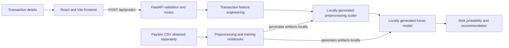

# Tranzacta

Tranzacta is a transaction-risk scoring project built around synthetic mobile-money transactions. A React interface submits transaction details to a FastAPI service, which validates the input, engineers model features, and returns a fraud-risk estimate from a locally generated Keras model.

**Live previews:** [Estatora](https://estatora.onrender.com/) · [VoltCast](https://voltcast.onrender.com/) · [Tranzacta](https://tranzacta.onrender.com/)

The score is an educational model estimate, not proof of fraud, a reason by itself to block a payment, or a substitute for investigation, fraud controls, or regulatory obligations.

## Contents

- [Project overview](#project-overview)
- [Problem and objectives](#problem-and-objectives)
- [Features](#features)
- [Prediction workflow](#prediction-workflow)
- [Dataset and preprocessing](#dataset-and-preprocessing)
- [Feature engineering](#feature-engineering)
- [Model training and evaluation](#model-training-and-evaluation)
- [Technology and architecture](#technology-and-architecture)
- [Repository structure](#repository-structure)
- [Prerequisites](#prerequisites)
- [Setup and running locally](#setup-and-running-locally)
- [Configuration](#configuration)
- [API usage](#api-usage)
- [Tests and build](#tests-and-build)
- [Implementation notes and limitations](#implementation-notes-and-limitations)
- [Security and data licensing](#security-and-data-licensing)
- [License](#license)

## Project overview

The browser collects a supported transaction type, hour, amount, and sender/receiver balances. The API validates the request, engineers the features used by the training workflow, applies saved preprocessing, and returns a risk score and threshold-based recommendation.

This is a source-only release. The dataset and generated model, preprocessing, and evaluation artifacts are not included. The API starts in a degraded state without its local inference artifacts and returns `503` for predictions until a compatible Keras model and preprocessing bundle are generated.

## Problem and objectives

Fraud detection is a classification problem where false positives and false negatives have real consequences. Tranzacta demonstrates a reproducible synthetic-data workflow and a typed model-serving API, while keeping the result framed as a risk estimate that requires human review.

## Features

- React interface for reviewing `TRANSFER` and `CASH_OUT` transactions.
- FastAPI request validation and JSON prediction responses.
- Engineered transaction features for amounts, balance changes, hour, and transaction type.
- A local Keras model and preprocessing scaler used by the serving API.
- Jupyter notebooks for preprocessing, model training, result analysis, and inference.
- Health, model-information, metrics, and prediction endpoints.
- Focused backend tests that do not require model artifacts.

## Prediction workflow

1. A user enters the transaction type, hour, amount, and before/after balances.
2. The browser sends the values to `POST /api/predict`.
3. Pydantic validates supported transaction types and numeric ranges and rejects unknown fields.
4. The service derives the model features, applies the saved preprocessing scaler, and invokes the local Keras model.
5. The API returns a risk classification, probability, and recommendation based on the configured threshold.

The input values are not proof that a transaction is legitimate or fraudulent.

## Dataset and preprocessing

The notebook workflow is based on [Synthetic Financial Datasets For Fraud Detection (PaySim)](https://www.kaggle.com/datasets/ealaxi/paysim1), created by Edgar Lopez-Rojas. Kaggle lists the dataset under [CC BY-SA 4.0](https://creativecommons.org/licenses/by-sa/4.0/). The dataset is not included in this repository.

If you obtain the dataset, review its terms, provide attribution, and indicate changes when sharing it. Place the full CSV at `backend/data/transactions.csv`. The preprocessing notebook converts transaction fields to numeric values, prepares training inputs, and writes local intermediate data and generated outputs. This repository does not establish the provenance of any separate local copy; the Kaggle page is the matching dataset reference, not a claim about a particular user's download.

PaySim is simulated mobile-money data and may not represent real customer behavior, fraud patterns, or current financial activity. For the source paper, see E. A. Lopez-Rojas, A. Elmir, and S. Axelsson, “PaySim: A financial mobile money simulator for fraud detection,” EMSS, 2016.

## Feature engineering

The serving service derives features such as log transaction amount, sender and receiver balance deltas, balance inconsistencies, transaction hour, night-time activity, high-value amounts, and transaction type. The exact ordered input columns and preprocessing behavior must match the locally generated artifacts.

The form and API support `TRANSFER` and `CASH_OUT`; support for other PaySim transaction types is not implemented in the serving interface.

## Model training and evaluation

The notebooks in `backend/notebooks/` are intended to be run in this order:

1. `preprocessing_pipeline.ipynb`
2. `model_training.ipynb`
3. `result_analysis.ipynb`
4. `model_inference.ipynb` demonstrates inference after compatible artifacts exist.

The training notebook compares multiple model families, but the FastAPI service currently serves a Keras model only. Notebook comparison results and generated weights, scalers, manifests, and intermediate outputs are not included. No model performance metrics are claimed for this source-only release.

## Technology and architecture

- **Frontend:** React 18, Vite 6, Tailwind CSS 4, and Lucide React.
- **API:** Python, FastAPI, Pydantic, and Uvicorn.
- **Inference and preprocessing:** TensorFlow/Keras, NumPy, pandas, and scikit-learn.
- **Research workflow:** Jupyter, PyTorch, PyTorch TabNet, and Matplotlib.
- **Testing:** pytest and FastAPI TestClient.



The serving API uses the Keras path. The notebook's experiments with other model families are research workflow and do not imply those models can be loaded by the current API.

## Repository structure

```text
Tranzacta/
├── backend/
│   ├── app/
│   │   ├── api/routes.py
│   │   ├── services/fraud_service.py
│   │   ├── config.py
│   │   ├── main.py
│   │   └── schemas.py
│   ├── notebooks/
│   │   ├── preprocessing_pipeline.ipynb
│   │   ├── model_training.ipynb
│   │   ├── result_analysis.ipynb
│   │   ├── model_inference.ipynb
│   │   └── requirements.txt
│   ├── .env.example
│   ├── requirements.txt
│   └── tests/test_api.py
├── frontend/
│   ├── public/
│   ├── src/
│   ├── .env.example
│   ├── package.json
│   └── package-lock.json
├── .gitignore
├── LICENSE
└── README.md
```

The local `backend/data/`, `backend/artifacts/`, `backend/models/`, and `backend/results/` directories are generated or user-provided and are not tracked.

## Prerequisites

- Python 3.11.
- Node.js 18 or newer and npm.
- Git.

## Setup and running locally

Clone the repository:

```bash
git clone https://github.com/srabonti-codes/tranzancta-financial-fraud-detection.git
cd tranzancta-financial-fraud-detection
```

### Backend

From `backend/`, create a virtual environment and install dependencies:

```powershell
py -3.11 -m venv .venv
.\.venv\Scripts\Activate.ps1
python -m pip install -r requirements.txt
Copy-Item .env.example .env
python -m uvicorn app.main:app --reload --host 127.0.0.1 --port 8000
```

The API documentation is available at `http://localhost:8000/api/docs`. Without local artifacts, `/api/health` reports a degraded state and `/api/predict` returns `503`.

### Frontend

In another terminal:

```powershell
cd frontend
npm ci
Copy-Item .env.example .env.local
npm run dev
```

Open the Vite URL printed in the terminal. The development server proxies `/api` requests to `http://localhost:8000`.

## Configuration

The example files contain local development settings, not credentials:

| File | Variable | Purpose |
|---|---|---|
| `backend/.env.example` | `APP_ENV`, `APP_NAME`, `APP_VERSION` | API metadata |
| `backend/.env.example` | `ALLOWED_ORIGINS` | Comma-separated browser origins permitted by CORS |
| `backend/.env.example` | `MODEL_PATH`, `MODEL_METADATA_PATH`, `PREPROCESSING_PATH` | Paths to generated local inference artifacts |
| `frontend/.env.example` | `VITE_API_URL` | Optional API origin; Vite uses the local proxy when unset |

Never put credentials or private values in `VITE_*` variables: Vite embeds them in browser code. Do not commit `.env` or `.env.local` files.

## API usage

Interactive API documentation is available at `http://localhost:8000/api/docs`.

| Method | Path | Purpose |
|---|---|---|
| `GET` | `/` | Service metadata |
| `GET` | `/health` | Service and model readiness |
| `GET`, `HEAD` | `/api/health` | API and model readiness |
| `GET` | `/api/model-info` | Model name, features, and supported transaction types |
| `GET` | `/api/metrics` | Available model evaluation metadata |
| `POST` | `/api/predict` | Score a transaction |

Example request:

```bash
curl -X POST http://localhost:8000/api/predict \
  -H "Content-Type: application/json" \
  -d '{
    "transaction_type": "TRANSFER",
    "hour": 14,
    "amount": 1250.0,
    "sender_balance_before": 5000.0,
    "sender_balance_after": 3750.0,
    "receiver_balance_before": 10000.0,
    "receiver_balance_after": 11250.0
  }'
```

## Tests and build

Run backend tests from `backend/`:

```bash
python -m pytest tests
```

Build the frontend from `frontend/`:

```bash
npm ci
npm run build
```

The generated frontend bundle is not source-controlled.

## Implementation notes and limitations

- The dataset and inference artifacts are not included. Predictions require a compatible local Keras model and preprocessing bundle.
- The API does not serve the non-Keras model families explored by the notebooks.
- The dataset is synthetic and can encode assumptions that do not reflect real institutions or current fraud tactics.
- The service has no user accounts, authentication, role-based permissions, or analyst/admin workflows.
- No production deployment configuration is included in this source-only repository.

## Security and data licensing

- The API has no authentication or rate limiting. Treat it as a local demonstration; add appropriate safeguards before hosting it for public or financial use.
- CORS allows only configured origins, disables credentials, and restricts methods and headers. Keep the frontend and API on trusted origins.
- The preprocessing bundle may use Python pickle serialization. Only load artifacts you generated or otherwise trust.
- The [PaySim Kaggle dataset](https://www.kaggle.com/datasets/ealaxi/paysim1) is listed under CC BY-SA 4.0. The dataset and model artifacts are excluded; provide attribution and follow the source terms if you obtain or share a copy.
- The Kaggle listing does not determine whether trained model weights are adapted material under ShareAlike. Review the license before redistributing dataset-derived artifacts.
- The root MIT license applies to original Tranzacta code, not the dataset or third-party dependencies.

## License

Original project code is provided under the [MIT License](./LICENSE). Dataset terms remain separate and must be checked at the source.
